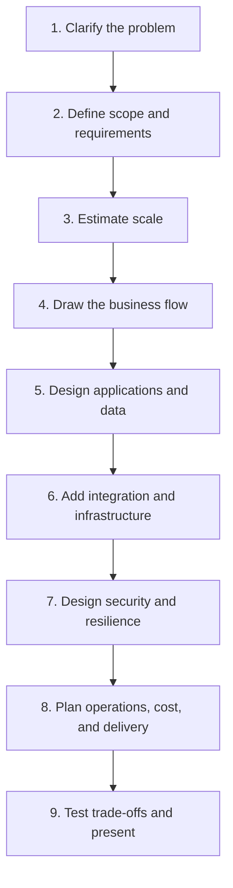

# Solutions Architect Use-Case Playbook

## How to approach any architecture problem from top to bottom

Someone gives you a use case:

> “Customers will order a new phone on Saturday, and delivery begins Friday. Design the system.”

The weakest response is to immediately draw API Gateway, Lambda, Kubernetes, Kafka, and a database.

A Solutions Architect begins differently:

> “Before I design anything, I want to understand the business result, users, scale, existing environment, constraints, and what failure means.”

That sentence changes the discussion from a technology quiz into an architecture conversation.

This playbook gives you a repeatable way to handle a classroom case, design review, customer meeting, or interview. You will not always have time to complete every section. Follow the order, go deeper where risk is highest, and state your assumptions.

---

## A quick way to use this playbook

Do not try to complete all nine stages at once. In a classroom exercise or interview, use three passes:

1. **Understand:** clarify the outcome, users, boundaries, constraints, and failure impact.
2. **Design:** follow the business flow, quantify the workload, and choose application, data, integration, and technology patterns.
3. **Defend:** explain security, resilience, operations, cost, trade-offs, and how you would validate the design.

At every stage, pause and ask: **What fact or assumption led me to this choice?** That question keeps the architecture grounded in evidence.

## The complete flow



A useful memory line is:

**Problem → People → Process → Scale → Data → Applications → Integration → Technology → Security → Operations → Decisions**

Do not memorize service names first. Memorize this thinking order.

---

# Part 1 — Understand before designing

## Step 1: Restate the problem

Translate the request into plain language.

Use this format:

> Today, **[user or team]** cannot **[complete an important task]** because **[current problem]**. This causes **[business impact]**. We need to improve **[measurable outcome]** without violating **[important constraint]**.

Example:

> Today, launch customers may see a delivery date that inventory and logistics cannot support because demand changes faster than planning systems update. This causes missed promises, cancellations, and support calls. We need to provide an accurate delivery promise while preventing oversell and respecting regional inventory rules.

If the problem statement contains a service name, remove it and try again. “We need Kafka” is not a business problem.

## Step 2: Identify the people

Ask who uses, owns, pays for, operates, approves, regulates, and is affected by the system.

| Group | What to learn |
| --- | --- |
| Customer or end user | What are they trying to complete? What frustrates them? |
| Business owner | Which outcome and KPI matter? |
| Operations team | What must they monitor, repair, and reconcile? |
| Security and compliance | What must be protected or proven? |
| Finance | What cost, budget, or revenue limit exists? |
| Engineering | What skills, systems, and delivery constraints exist? |
| External party | Which carrier, payment provider, supplier, or government system is involved? |

A stakeholder is not just a name. Record the decision each stakeholder makes.

## Step 3: Ask clarifying questions

Do not ask twenty random questions. Ask the few that can change the design.

### Business

- What result must improve?
- What happens if we do nothing?
- What does success look like after three months?
- Is this revenue-critical, safety-critical, regulated, or internal?
- Is the priority speed, correctness, availability, cost, or time to market?

### Users and geography

- Who uses it: customers, employees, partners, machines, or other systems?
- How many users are active normally and at peak?
- Which countries or regions are served?
- Are there accessibility, language, or data-residency requirements?

### Workload

- Is it transactional, analytical, streaming, batch, ML, file-based, or mixed?
- Is traffic steady, seasonal, scheduled, or unpredictable?
- What creates the peak?
- What is the read-to-write ratio?
- Are requests independent, or must they happen in order?

### Existing environment

- What already exists?
- Which system is the source of truth?
- What cannot be changed now?
- Are there on-premises systems, legacy databases, licenses, or vendor contracts?
- Which interfaces are synchronous, batch, file, or event-based?
- What skills can the team support?

### Risk

- What is the worst believable failure?
- Can the business tolerate incorrect data?
- Can a transaction be processed twice?
- How much downtime and data loss are acceptable?
- What must still work when the internet, a region, or a dependency fails?

If the person cannot answer, write an assumption. Never silently invent a fact.

## Step 4: Separate facts, assumptions, constraints, and decisions

| Type | Meaning | Example |
| --- | --- | --- |
| Fact | Confirmed information | Orders open Saturday. |
| Assumption | Used until someone confirms it | Peak is 100,000 orders per minute. |
| Constraint | A limit the design must respect | Customer data must stay in-region. |
| Decision | A selected approach with a reason | Use asynchronous order events to isolate fulfillment. |
| Risk | Something uncertain that may cause harm | Carrier capacity may be unavailable on launch day. |
| Open question | Information still needed | Can stores fulfill online orders? |

This separation prevents an assumption from becoming an accidental architecture requirement.

## Step 5: Set the scope

Draw a simple context boundary:

- What is inside your solution?
- What is outside?
- Which external systems do you depend on?
- Which teams own those systems?
- What will this version deliberately not solve?

Use three scope labels:

- **Now:** required for the first release.
- **Next:** valuable after the core flow works.
- **Not in scope:** explicitly excluded.

Without a boundary, every design grows until it becomes impossible to deliver.

---

# Part 2 — Turn the need into requirements

## Step 6: Write the main user journeys

Follow a real person or business item from beginning to end.

For the phone launch:

1. Customer chooses a configuration.
2. System shows price and delivery date.
3. Customer submits payment.
4. Inventory is held.
5. Order is confirmed.
6. Unit is allocated to a fulfillment location.
7. Warehouse packs and ships it.
8. Carrier reports progress.
9. Customer receives the phone.
10. Returns or support may follow.

Also write:

- one administrator journey;
- one operations journey;
- one failure journey;
- one recovery or reconciliation journey.

The happy path is only the beginning of the design.

## Step 7: Capture functional requirements

Functional requirements describe what the system must do.

Write them so they can be tested:

- The customer can search available products by market.
- The system calculates price, tax, and delivery promise before payment.
- The system prevents two confirmed orders from using the same unit.
- An operator can trace an order from checkout through delivery.
- A customer is notified when a confirmed delivery date changes.

Avoid vague statements such as “The system supports inventory.”

## Step 8: Capture non-functional requirements

Non-functional requirements describe how well the system must work.

| Area | Questions | Example measure |
| --- | --- | --- |
| Availability | How often must the user succeed? | 99.99% checkout availability during launch |
| Latency | How fast at normal and peak load? | p95 under 300 ms |
| Scale | How many users, requests, events, or files? | 50,000 order attempts/second |
| Durability | Can acknowledged data be lost? | No confirmed order loss |
| Consistency | How current and correct must state be? | Strong consistency for inventory hold |
| Recovery | How quickly must service return? | RTO 15 minutes |
| Data loss | How much recent data may be lost? | RPO less than 1 minute |
| Security | Who can do what? | Least privilege and MFA for operators |
| Privacy | Where and how long may data be stored? | Regional storage; delete after policy period |
| Observability | How will teams know it is broken? | Customer-success rate and queue-age alarms |
| Cost | What is the financial boundary? | Cost per completed order |
| Maintainability | How safely can it change? | Automated tests and progressive deployment |

### Four terms every architect must explain

- **SLA:** the commitment made to the customer.
- **SLO:** the internal target used to meet that commitment.
- **RTO:** how long recovery may take.
- **RPO:** how much recent data may be lost.

Do not automatically say zero RTO and zero RPO. Those promises are expensive and may be unrealistic.

## Step 9: Prioritize

Use a simple order:

- **Must:** the business cannot launch without it.
- **Should:** important, but a controlled workaround exists.
- **Could:** useful improvement.
- **Later:** intentionally postponed.

Ask: “If we have half the expected time, what still has to work?”

That answer identifies the minimum viable architecture.

---

# Part 3 — Quantify the workload

## Step 10: Estimate traffic

Start with business numbers, then derive technical numbers.

### Requests per second

```text
requests per second =
active users × actions per user in the period ÷ seconds in the period
```

Example:

```text
3,000,000 active customers × 4 requests in 10 minutes ÷ 600 seconds
= 20,000 requests/second average during the window
```

Then apply peak behavior and headroom:

```text
planned peak = calculated average × peak factor × headroom
```

If the peak factor is 3 and headroom is 30%:

```text
20,000 × 3 × 1.3 = 78,000 requests/second
```

State whether the number represents HTTP requests, business transactions, database writes, or events. They are not the same.

## Step 11: Estimate storage

```text
daily storage =
records per day × average record size × replication/overhead
```

```text
retained storage =
daily storage × retention days
```

Add indexes, replicas, backups, logs, images, and growth. Raw payload size alone is not a capacity plan.

## Step 12: Estimate network

```text
network throughput =
messages per second × average message size
```

Convert units carefully:

```text
bits per second = bytes per second × 8
```

For video, files, or cross-region replication, calculate inbound, outbound, and inter-region traffic separately.

## Step 13: Estimate concurrency

```text
concurrent operations =
arrival rate per second × average processing time in seconds
```

If 10,000 requests arrive each second and each stays active for 0.2 seconds:

```text
10,000 × 0.2 = 2,000 concurrent requests
```

## Step 14: Find the bottleneck

Capacity is not one number. Check every stage:

- edge and network;
- API and application compute;
- connection pools;
- database reads and writes;
- partitions and hot keys;
- queues and consumer rate;
- third-party rate limits;
- warehouse, store, or human processing capacity.

A system can have enough servers and still fail because the payment provider accepts only 2,000 calls per second.

Always answer:

1. What fills first?
2. How will we detect it?
3. What happens after it fills?
4. How long will recovery take?

---

# Part 4 — Design the logical solution

## Step 15: Draw the simplest end-to-end flow

Begin with five to eight boxes, not fifty:

```text
User → Channel → Core business service → System of record
                         ↓
                  Downstream processing
                         ↓
                  Operations and analytics
```

Tell the story aloud. If a business stakeholder cannot follow it, simplify it.

## Step 16: Divide responsibilities

Group capabilities around business responsibilities:

- customer experience;
- identity;
- catalog and pricing;
- order;
- payment;
- inventory;
- fulfillment;
- notification;
- analytics.

Do not create a microservice for every noun. Split a capability only when there is a real reason such as independent ownership, scaling, security, release cycle, or failure isolation.

For every component, write:

- its responsibility;
- its owner;
- its inputs and outputs;
- its authoritative data;
- its availability need;
- what happens when it is unavailable.

## Step 17: Choose synchronous or asynchronous interaction

### Use synchronous interaction when

- the caller needs an immediate answer;
- the operation is short;
- the dependency is required to continue;
- the customer must know success or failure now.

Example: checking whether an inventory hold succeeded before confirming an order.

### Use asynchronous interaction when

- work can continue later;
- traffic needs buffering;
- producers and consumers should fail independently;
- multiple consumers need the same business event;
- retry and replay are valuable.

Example: sending a confirmed order to fulfillment, analytics, forecasting, and customer support.

Asynchronous does not mean automatically reliable. You must design duplicates, ordering, retries, poison messages, dead-letter handling, replay, and reconciliation.

## Step 18: Define API and event contracts

For every important interface, record:

- name and business meaning;
- producer and owner;
- consumers;
- request or event schema;
- business key;
- idempotency key;
- timestamps;
- version;
- ordering requirement;
- timeout and retry;
- authentication and authorization;
- failure response;
- SLO;
- data classification.

An event should describe something that happened, such as `OrderConfirmed`. A command asks another system to act, such as `AllocateInventory`. Do not confuse them.

## Step 19: Design idempotency

Networks retry. Users double-click. Messages are delivered more than once.

For a business operation:

1. Client sends a unique idempotency key.
2. Service checks whether that key was processed.
3. If it is new, the service performs the action and records the result atomically.
4. If it already exists, the service returns the original result.
5. Downstream consumers also remember processed event IDs or make updates naturally idempotent.

“Exactly once” is usually a business outcome created through design, not a magical transport guarantee.

---

# Part 5 — Design the data

## Step 20: Name the business entities

Examples:

- Customer
- Product
- InventoryPosition
- InventoryHold
- Order
- Payment
- Shipment
- DeliveryPromise

For each entity, define:

- business meaning;
- unique identifier;
- owner;
- system of record;
- lifecycle and status;
- relationships;
- sensitive fields;
- retention;
- quality rules.

## Step 21: Choose consistency deliberately

Use strong consistency when an incorrect concurrent decision creates unacceptable harm:

- money movement;
- confirmed inventory reservation;
- unique identity;
- entitlement or permission;
- final order status transition.

Use eventual consistency when a short delay is acceptable:

- dashboard totals;
- recommendations;
- search index;
- analytics;
- customer activity feed.

Do not call the whole system strongly or eventually consistent. Make the decision per business operation.

## Step 22: Select a data pattern

| Need | Common fit |
| --- | --- |
| Transactions and relationships | Relational database |
| Predictable key-value access at high scale | Key-value/NoSQL database |
| Flexible document records | Document database |
| Search and text relevance | Search engine |
| Cache and short-lived state | In-memory store |
| Files, logs, images, and data lake | Object storage |
| Historical analytics | Warehouse or lakehouse |
| Relationships and paths | Graph database |
| Time-ordered measurements | Time-series database |

Choose based on access pattern, correctness, scale, operations, and cost—not fashion.

## Step 23: Separate operational and analytical workloads

Operational systems answer immediate business questions:

- Is this item available?
- Did the payment succeed?
- What is this order’s current status?

Analytical systems answer wider questions:

- Which configurations are trending?
- Why are delivery promises being missed?
- How accurate was the forecast?

Do not run a massive analytical query against the database serving live checkout. Move data through controlled replication, change data capture, events, or scheduled pipelines.

## Step 24: Plan data quality and reconciliation

For critical data, define:

- completeness;
- validity;
- uniqueness;
- timeliness;
- consistency;
- ownership;
- correction process.

Ask: “If the order system says confirmed but inventory says no reservation, which system wins, who is alerted, and how is the customer protected?”

Every distributed business process needs reconciliation.

---

# Part 6 — Map the logical design to AWS

Only now should you select services.

## Step 25: Choose compute

| Situation | AWS direction to evaluate |
| --- | --- |
| Short event-driven work with variable demand | Lambda |
| Containerized services without managing servers | ECS with Fargate |
| Kubernetes is a real organizational requirement | EKS |
| Full OS control, special software, or predictable workloads | EC2 |
| Batch jobs | AWS Batch |
| Edge or disconnected site | Outposts, Local Zones, IoT/edge patterns as appropriate |

The question is not “Which service is best?” It is “Which service fits this workload and this team?”

Compare operational burden, scaling behavior, startup time, limits, portability, skills, and cost.

## Step 26: Choose storage and databases

| Need | AWS direction to evaluate |
| --- | --- |
| Relational transactions | Aurora or RDS |
| High-scale key-value access | DynamoDB |
| Object and data-lake storage | S3 |
| Cache | ElastiCache |
| Search | OpenSearch Service |
| Warehouse analytics | Redshift |
| Shared file system | EFS |
| Block storage for compute | EBS |
| Graph relationships | Neptune |
| Time-series data | Timestream |

Start from the access pattern and consistency need. Do not choose a database because its name appeared in another architecture.

## Step 27: Choose integration

| Need | AWS direction to evaluate |
| --- | --- |
| Durable work queue and buffering | SQS |
| Publish to several subscribers | SNS |
| Route business events by rules | EventBridge |
| High-throughput ordered event stream | Kinesis or Amazon MSK |
| Managed workflow with visible steps | Step Functions |
| API entry and governance | API Gateway |
| Service-to-service load balancing | Elastic Load Balancing |

A queue, topic, event bus, and stream solve different problems. Explain delivery, ordering, retention, replay, and consumer behavior.

## Step 28: Design the network

At minimum, show:

- accounts and regions;
- VPCs and subnets;
- public and private boundaries;
- internet entry;
- routing;
- security groups and network controls;
- outbound access;
- hybrid connectivity;
- DNS;
- load balancers;
- private access to managed services;
- inspection and logging.

Keep application workloads private unless public exposure is required. Public users normally enter through an edge, API, or load-balancing layer rather than connecting directly to a server or database.

## Step 29: Use Well-Architected questions

Review the design through six lenses:

1. **Operational excellence:** Can the team deploy, observe, and improve it safely?
2. **Security:** Are identity, data, and systems protected?
3. **Reliability:** Does it recover and continue through failure?
4. **Performance efficiency:** Does it use the right resources as demand changes?
5. **Cost optimization:** Is the cost understood and controlled?
6. **Sustainability:** Does it avoid unnecessary resource use?

These lenses are a review, not a substitute for understanding the business.

---

# Part 7 — Secure the system

## Step 30: Draw trust boundaries

Mark where trust changes:

- internet to edge;
- user to application;
- application to application;
- cloud to on-premises;
- company to partner;
- production to administration;
- one customer or tenant to another.

For each crossing, ask who or what is authenticated, what is authorized, what is encrypted, and what is logged.

## Step 31: Apply identity and least privilege

Separate:

- customer identity;
- employee identity;
- workload identity;
- emergency administrative access.

Grant only the actions and resources needed. Prefer short-lived credentials and roles over stored access keys. Require strong authentication for privileged actions.

## Step 32: Protect data

Classify data before choosing controls:

- public;
- internal;
- confidential;
- restricted.

Then define:

- encryption in transit and at rest;
- key ownership and rotation;
- tokenization or masking;
- secrets storage;
- backup protection;
- regional residency;
- retention and deletion;
- access logging.

## Step 33: Threat-model the design

Use practical questions:

- Can someone impersonate a user or service?
- Can a request or event be changed?
- Can someone deny performing an action?
- Can sensitive information leak?
- Can traffic exhaust the service?
- Can a user gain a higher privilege?
- Can a compromised dependency move further into the system?

For each important threat, state prevention, detection, containment, and recovery.

Security is not one box labeled “WAF.”

---

# Part 8 — Design for failure

## Step 34: List dependencies and failure modes

For every component and external service, ask:

- What if it is slow?
- What if it is unavailable?
- What if it returns the wrong result?
- What if the response times out after the operation succeeded?
- What if data is duplicated, missing, late, or out of order?
- What if an entire Availability Zone or Region is lost?

## Step 35: Select resilience patterns

Use only where they solve a stated failure:

- timeout;
- bounded retry with backoff and jitter;
- circuit breaker;
- bulkhead or isolated resource pool;
- queue and backpressure;
- load shedding;
- rate limiting;
- health-based failover;
- multi-AZ deployment;
- backup and restore;
- active-passive regional recovery;
- active-active regional operation;
- graceful degradation;
- reconciliation.

Retries without limits can turn a small failure into a complete outage.

## Step 36: Define degraded behavior

Examples:

- If recommendations fail, show popular products.
- If forecasting fails, use the last approved forecast plus a conservative rule.
- If a carrier API fails, accept the order only with a wider delivery range.
- If analytics is delayed, checkout continues because analytics is not in the transaction path.
- If inventory truth is unavailable, stop confirming inventory rather than oversell.

A strong architecture says what still works, not only how quickly everything returns.

## Step 37: Design backup and disaster recovery

Decide:

- what is backed up;
- how often;
- where copies are stored;
- whether backups are immutable;
- who can restore;
- how restoration is tested;
- how DNS, traffic, data, and dependencies fail over;
- how the system returns to normal after recovery.

A backup is not proven until a restore test succeeds.

---

# Part 9 — Make the system operable

## Step 38: Define observability

Use four kinds of signals:

| Signal | Example |
| --- | --- |
| Customer | Checkout success rate, playback starts, promised-date accuracy |
| Business | Orders confirmed, payment failures, inventory shortage |
| Application | Latency, error rate, saturation, dependency failures |
| Infrastructure | CPU, memory, connections, disk, queue depth |

Also include logs, metrics, traces, correlation IDs, dashboards, and alerts.

Alert on symptoms that require action. Do not page someone only because CPU reached an arbitrary number.

## Step 39: Write the incident path

For each serious alarm:

1. Who receives it?
2. What does the dashboard show?
3. What is the first safe action?
4. Is there an automated containment?
5. When is the business owner informed?
6. How is recovery verified?
7. How are missed or duplicated transactions reconciled?
8. What evidence is kept for the review?

## Step 40: Plan deployment and change

Define:

- infrastructure as code;
- automated build and tests;
- security scanning;
- environment promotion;
- database-change compatibility;
- canary, rolling, or blue/green deployment;
- feature flags;
- rollback;
- approvals for high-risk changes;
- audit history.

A deployment is incomplete until rollback is safe.

---

# Part 10 — Cost and delivery

## Step 41: Find the cost drivers

Typical drivers include:

- always-running compute;
- peak compute;
- stored data and retention;
- requests and transactions;
- data transfer;
- cross-region replication;
- logs and observability;
- licenses;
- premium support;
- people operating the system.

Track a business unit cost such as:

- cost per completed order;
- cost per active customer;
- cost per streamed hour;
- cost per forecast;
- cost per gigabyte processed.

The cheapest architecture is not useful if it loses orders. The most reliable possible architecture may be unaffordable. Show the trade-off.

## Step 42: Plan delivery in stages

A practical roadmap:

### Phase 0 — Prove the risky assumption

Test the part most likely to invalidate the design: throughput, database contention, external API capacity, ML accuracy, or migration compatibility.

### Phase 1 — Minimum viable production

Deliver the main business journey with security, monitoring, recovery, and manual fallback.

### Phase 2 — Scale and automate

Add advanced optimization, wider integration, automation, regional expansion, or ML after the core system is trustworthy.

### Phase 3 — Improve using evidence

Use production metrics, incidents, customer behavior, and cost data to revise the design.

Do not call a system “MVP” if it has no security, monitoring, backup, or recovery. Those are production requirements.

## Step 43: Plan migration

When replacing an existing system, decide:

- big bang or incremental migration;
- which capability moves first;
- data migration and validation;
- dual-write risks;
- synchronization during transition;
- cutover criteria;
- rollback;
- decommissioning;
- audit and retention.

Useful patterns include rehost, replatform, refactor, repurchase, retain, and retire. Select per application, not once for the whole company.

---

# Part 11 — Record and defend decisions

## Step 44: Write architecture decisions

For each major decision, record:

- **Context:** What problem and constraints led here?
- **Decision:** What did we choose?
- **Options:** What realistic alternatives did we compare?
- **Reason:** Why does this option fit better?
- **Consequences:** What do we gain and what cost or limitation do we accept?
- **Reversal evidence:** What new fact would make us change the decision?
- **Status and owner:** Proposed, accepted, superseded, or rejected.

Good decisions usually involve trade-offs:

- synchronous versus asynchronous;
- relational versus NoSQL;
- serverless versus containers;
- single region versus multi-region;
- buy versus build;
- real-time versus batch;
- consistency versus availability;
- cost versus recovery speed.

If every decision has only advantages, the analysis is incomplete.

## Step 45: Validate before presenting

Check the design from several views.

### Business check

- Does it solve the stated problem?
- Are success measures clear?
- Is the scope realistic?

### Correctness check

- Is there one owner for critical data?
- Can money, inventory, or commands be duplicated?
- Are timeouts and retries safe?

### Scale check

- Are peak numbers calculated?
- Is the first bottleneck known?
- Can backlog be cleared after recovery?

### Failure check

- Are dependencies allowed to fail?
- Is degraded behavior defined?
- Are RTO and RPO supported by the design?

### Security check

- Are trust boundaries visible?
- Is least privilege used?
- Are sensitive data, keys, and audit trails covered?

### Operations check

- Can someone deploy, observe, recover, and reconcile it?
- Is ownership clear at 2:00 a.m.?

### Cost check

- What are the main cost drivers?
- What happens to cost at 10x scale?

### Consistency check

- Do diagrams, requirements, numbers, contracts, and written decisions agree?

---

# Part 12 — Present the architecture

## A ten-minute design-review flow

### Minute 0–1: Problem and outcome

Explain who has the problem, what harm it creates, and what success means.

### Minute 1–2: Scope and assumptions

State what is included, excluded, uncertain, and constrained.

### Minute 2–4: Main business flow

Follow one real user or transaction from start to finish.

### Minute 4–6: Architecture

Explain responsibilities, data ownership, integration, and why the main patterns were selected.

### Minute 6–7: Scale

Show two or three calculations and identify the first bottleneck.

### Minute 7–8: Security and failure

Show trust boundaries, the most serious failure, degraded behavior, RTO, and RPO.

### Minute 8–9: Trade-off

Defend one important decision and name its downside.

### Minute 9–10: Delivery and ask

Explain phases, biggest remaining risk, and the decision or support you need.

## A strong opening

> “I’ll begin with the customer and business outcome, clarify the assumptions I used, walk through the main transaction, and then cover scale, data, failure, security, cost, and trade-offs.”

## A strong closing

> “The design protects the most important business outcome by keeping the critical transaction small and correct, moving non-critical work asynchronously, and providing a safe degraded mode. The largest risk is the external dependency limit, so Phase 0 validates that assumption before full delivery.”

---

# Fast interview version

If you have only 30–45 minutes:

1. Clarify the use case and state assumptions.
2. Define the main user journey.
3. Estimate users, requests, data, and peak.
4. Draw the high-level flow.
5. Deep-dive into the hardest data or consistency decision.
6. Add one failure and recovery path.
7. Cover security boundaries.
8. State the main trade-off, bottleneck, and next improvement.

Keep talking while drawing. The reviewer is evaluating your decisions, not your artistic skill.

When the interviewer adds a new requirement, do not erase everything immediately. Say:

> “That changes the availability and data-residency assumptions. I would keep the core flow, but revise these two parts…”

That demonstrates controlled architectural thinking.

---

# Common mistakes

## Starting with services

Weak:

> “I will use Lambda, DynamoDB, and Kafka.”

Better:

> “The order path needs immediate confirmation and strong inventory correctness. Fulfillment can happen asynchronously, so I will separate those responsibilities before selecting services.”

## Designing only the happy path

Ask what happens when the database, network, queue, payment provider, or operator fails.

## Claiming unlimited scale

Every service has quotas, partitions, connections, cost, downstream limits, and recovery behavior.

## Saying “multi-region” without explaining state

Show traffic routing, data replication, write ownership, conflict behavior, failover trigger, and failback.

## Treating cache as truth

A cache improves speed. It should not quietly become the authority for money, inventory, or permission.

## Using eventual consistency everywhere

A delayed dashboard may be acceptable. Selling the same phone twice is not.

## Using microservices without ownership

More services create more networks, releases, contracts, monitoring, failures, and team coordination.

## Forgetting people

Manual approval, customer support, security operations, finance, and reconciliation are parts of the system.

## Adding ML without a decision

Name the decision ML improves, how it is evaluated, who can override it, and what happens when it fails.

## Giving no downside

Architecture is trade-offs. State the cost you accept.

---

# Reusable worksheet

Copy this section when a new use case is assigned.

## 1. Problem

- User or stakeholder:
- Current problem:
- Business impact:
- Desired measurable outcome:

## 2. Scope

- In scope:
- Out of scope:
- Existing systems:
- External dependencies:

## 3. Facts and unknowns

- Confirmed facts:
- Assumptions:
- Constraints:
- Open questions:
- Main risks:

## 4. Requirements

- Main user journeys:
- Functional requirements:
- Availability:
- Latency:
- Scale:
- Consistency:
- RTO:
- RPO:
- Security/privacy:
- Cost limit:

## 5. Capacity

- Normal and peak users:
- Requests/second:
- Concurrent operations:
- Read/write ratio:
- Events/second:
- Storage/day and retention:
- Network throughput:
- Third-party limits:
- First bottleneck:
- Headroom:

## 6. Logical design

- Business capabilities:
- Application responsibilities:
- System of record for each key entity:
- Synchronous calls:
- Asynchronous events:
- Idempotency approach:
- Reconciliation approach:

## 7. AWS mapping

- Edge and DNS:
- Network:
- Compute:
- Database:
- Object/file storage:
- Cache:
- Messaging:
- Analytics:
- Identity and secrets:
- Monitoring:
- Backup and disaster recovery:

## 8. Failure and security

- Top five failures:
- Degraded mode:
- Recovery:
- Trust boundaries:
- Top five threats:
- Prevent/detect/respond controls:

## 9. Delivery and operations

- Phase 0 test:
- MVP:
- Later phases:
- Deployment and rollback:
- Dashboard and alarms:
- On-call owner:
- Cost drivers:

## 10. Decisions

- ADR 1:
- ADR 2:
- Largest downside:
- Evidence that would reverse the decision:

## 11. Presentation

- One-minute problem:
- Main flow:
- Two calculations:
- Most important failure:
- Most important security control:
- Main trade-off:
- Final recommendation:

---

# Final rule

A Solutions Architect does not win by drawing the most boxes.

A strong architect can explain:

- why the system is needed;
- who depends on it;
- what must remain correct;
- how much load it must handle;
- where the data lives and who owns it;
- how components communicate;
- what happens when something fails;
- how the system is secured and operated;
- what the design costs;
- which trade-offs were accepted;
- and what evidence would cause the design to change.

If you can explain those points clearly, from the business problem down to the recovery procedure, you are approaching the use case like a Solutions Architect.

---

[← Course home](README.md) · [Course map](COURSE_MAP.md) · [Apple Event challenge](use-cases/apple-event-enterprise-challenge/README.md)
