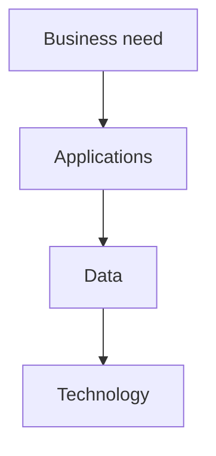
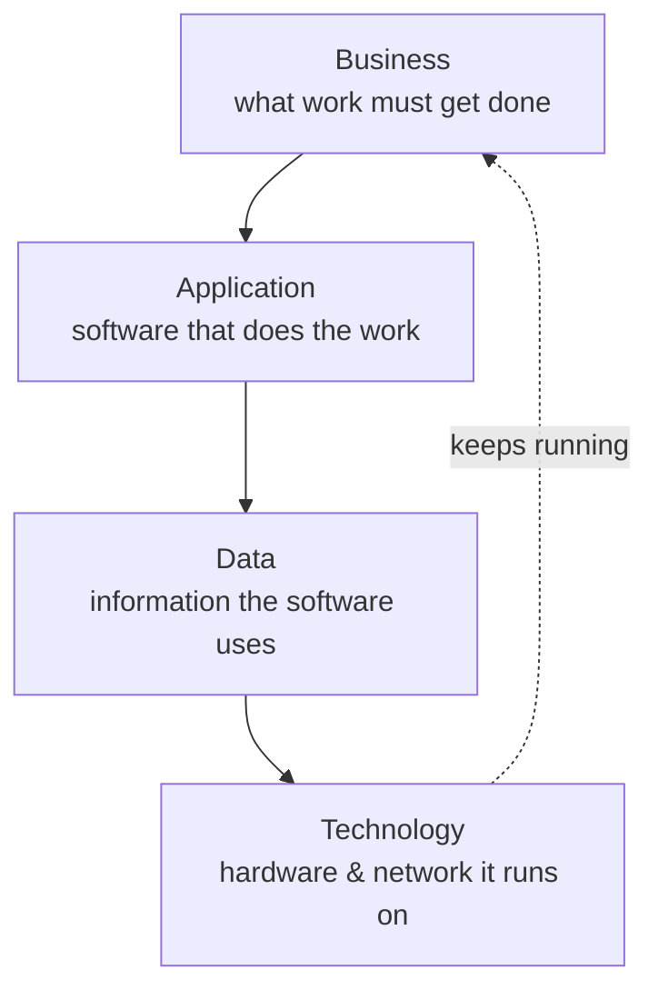

# Session 1: Enterprise System Design: How a Company Keeps Its Business Running

## Your path through this session

Start here. By the end, you should be able to spot the hidden system behind an ordinary business activity.

**Start with:** the opening story.  
**Work on:** the activity using your own team project.  
**Keep:** the artifact named in “What you’ll produce”; you will use it in the next session.

You do not need industry experience for this session. If you have used a college login, banking app, hospital portal, or work laptop, you already have enough experience to begin.

## A familiar example before we begin

Think about your college login. One username may open email, the learning portal, exam registration, library services, and Wi-Fi. When it works, it feels like one simple login. Behind it are identity records, applications, networks, security rules, support teams, and data that must agree. The new-employee story in this session reveals the same hidden system at company scale.

## Enterprise Architecture in one picture

Enterprise Architecture is the overall plan that connects a business need to the applications, data, and technology required to deliver it.



For example, Campus Bank wants customers to transfer money online. The transfer is the business need. Mobile and transfer services support it. Customer, account, and transaction records provide the data. Servers, networks, and security controls provide the technology. EA makes sure those four views support the same outcome.

The employee-onboarding story is a second example. Priya is not the architecture; her first productive working day is the business outcome. Her story helps us uncover the connected parts required to deliver that outcome.

## What you will be able to do after this session

- Explain, in your own words, why a company needs more than "one working program" to run its business.
- Walk through everything that has to happen before a new employee can start work — and see that this is already a small enterprise system.
- Explain what "Business as Usual" means and why it doesn't happen by accident.
- Name the four things every company's technology decisions are really about: business, applications, data, and technology.
- Explain, with a real-sounding example, why poor system design can hurt a business.

## How this session is organized

This session has a natural two-part shape, with a real break in the middle — not a countdown to a fixed timestamp.

| Part | What it covers | Typical range (a guide, not a limit) |
|---|---|---|
| **Part 1** — understand, through one story | Why this course exists, one new employee's laptop, and what "Business as Usual" means | Often 40–55 minutes, depending on discussion |
| **Ten-minute break** | A real stopping point, not a rushed pause | ~10 minutes |
| **Part 2** — apply, by zooming out | From one laptop to a whole company, three failure stories, and a first look at the four views | Often 35–55 minutes, depending on discussion |

If discussion is genuinely helping students understand — more questions, more examples, someone still confused — let it run past the "typical range." Take the time you need. The ideas matter more than finishing every section in one sitting.

---

# Part 1 — Understand, through one story

## 1. The question we're here to answer

Here's the question I want you to carry through this entire session:

> **What technology does a large company need before even one employee can perform their job?**

Not "what app does the company sell." Not "what's on their website." Just — one person, joining one company, on their first day. What has to already exist for that one person to open a laptop and start working?

We're going to answer this slowly, with a real story, because the answer is bigger than most people expect. And once you see it for one employee, you'll be able to see it for an entire company — banks, airlines, hospitals, colleges, retail chains, energy companies. That's this whole course, actually: learning to see the system behind something that looks simple.

## 2. Why this course is part of your curriculum

You've spent time learning to write programs, and you're good at it — that's a real, separate skill from what this course teaches, not a lesser one. A program you write for an assignment has to be correct. A company's technology has to be correct *and* available to thousands of people at once *and* secure *and* affordable *and* still working the same way five years from now, after several different teams have touched it. Nobody teaches you that second part by writing more code — you learn it by looking at how a real company actually operates. That's this course.

Here's what a lone working program usually doesn't handle once it enters a real company:

- It can't support the number of users a real company has.
- It's too slow once real traffic hits it.
- It goes down during a failure, and nobody designed for that.
- It leaks information it shouldn't.
- It doesn't talk to the systems the company already has.
- Nobody can tell what it's doing once it's running — there's no way to monitor it.
- It can't be safely updated without breaking something.
- It creates a second copy of data that quietly disagrees with the first copy.
- It costs more to run than the value it creates.
- It breaks a legal or company rule nobody thought to check.
- When it breaks at 2 AM, the support team has no idea how to fix it.
- It solves a technical puzzle — but not the actual problem the business had.

Programming courses teach you how to build the pieces. **This course teaches you how those pieces have to fit into a company that already exists, already has rules, and already can't afford to stop running.** That's the entire gap this course fills. It's the difference between "I can write code" and "I understand why a company's technology looks the way it does."

## 3. Where this course is going

This course is called **Enterprise System Design**. Over the next several sessions, we're going to follow one continuing example — a fictional bank called **Campus Bank** — from "what problem is this business trying to solve" all the way to "here's the full design, and here's why we made each decision."

The path looks like this:

```
Understand the business → figure out what's needed → look at what already exists
  → design the solution → weigh the trade-offs → keep it running safely → improve it over time
```

Today, we only do the first step: understanding why a business needs this kind of thinking at all. We are not going to open any code today. We are not going to draw a complicated diagram today. We're going to tell one story, and by the end of it, you'll already be thinking like someone who designs enterprise systems — even if you've never heard that phrase before this evening.

## 4. The story of a new employee's laptop

Imagine a large company — could be a bank, an airline, a hospital, doesn't matter which yet — and imagine someone just got hired. Let's call her Priya. It's her first day. Before she can do anything on a computer, here's what actually has to happen, in order:

1. **HR creates her employee record.** The company now officially knows Priya exists as an employee.
2. **Her manager requests a laptop for her.** Someone has to formally ask for the equipment.
3. **Procurement buys or assigns a laptop.** Somebody owns the budget and the physical device.
4. **IT records the laptop as a company asset.** It gets a tag, a serial number, an owner — the company now tracks it, just like it tracks money.
5. **The laptop is set up** with an operating system and the software the company has approved.
6. **Security is applied** — encryption, antivirus, rules about what she can and can't install.
7. **Priya gets a digital identity** — a username, a company email address.
8. **She's given access to the specific applications her job needs** — not every system in the company, just the ones for her role.
9. **The laptop and her applications are watched over** — if something breaks, someone is responsible for fixing it.
10. **Software gets patched and updated** over time, usually without her even noticing.
11. **If Priya changes roles** next year, her access changes with her — new systems added, old ones removed.
12. **If Priya ever leaves the company**, her access is shut off and the laptop is collected.

Read that list again. That's twelve separate things that had to happen — reliably, correctly, and mostly invisibly — before Priya could even open her email.

**Every one of the twelve steps quietly touches all of these:**

- **People** — HR, her manager, IT staff, security staff
- **Business processes** — hiring, onboarding, offboarding
- **Software applications** — the systems she'll use for her job
- **Data** — her employee record, her identity, her access permissions
- **Hardware** — the physical laptop
- **Networks** — how her laptop connects to company systems
- **Security** — who can access what, and how it's protected
- **Vendors** — the company that made the laptop, the company that hosts the email service
- **Policies** — rules about what software is allowed, how long data is kept
- **Support teams** — the people who fix things when they break
- **Costs** — someone pays for every laptop, every license, every hour of IT time
- **Compliance** — rules the company must follow, sometimes by law
- **Architecture decisions** — someone decided, in advance, how all of this fits together

Nobody wrote "architecture" on a whiteboard to make Priya's laptop work. But everything on that list *is* architecture — decisions made ahead of time so that this process works the same way for the next new employee, and the next, and the next.

**Take a moment here.** Before moving on, it's worth actually pausing class discussion — ask what people noticed, what surprised them, whether anyone has lived through part of this list themselves (a new student ID, a new internship laptop). Let that conversation run as long as it's genuinely useful. This is not a section to rush through to stay on schedule.

## 5. What "Business as Usual" means

All twelve of those steps, working together, every single day, for every employee — that has a name:

> **Business as Usual (BAU) means the organization can keep doing its normal daily work, reliably, every day.**

BAU is not automatic. It's the result of many people and many teams working together, continuously — not a one-time event like Priya's first day, but something that has to keep holding true every day after that too.

## Part 1 checkpoint

Here's the idea to hold onto before we take a break:

> **A laptop is not useful merely because the company purchased it. It becomes useful only when people, processes, applications, data, infrastructure, security, and support work together.**

That's Part 1. If your class needs more time here — more questions, more examples, more discussion — that's completely fine. Part 2 builds directly on this, so it's worth actually reaching this understanding before moving on, rather than moving on because the clock says to.

---

## Ten-minute break

Stretch, get water, step away from the screen. This is a real break, not a thirty-second pause — take the full time.

---

# Part 2 — Apply, by zooming out

## 6. Recap: where we left off

Before the break, we followed one new employee's laptop and found nine or ten different teams quietly depending on each other to make it work — and we landed on the idea that a laptop alone is never enough; it takes people, process, data, infrastructure, security, and support all working together. That's Business as Usual for one employee. Now let's see what it looks like for an entire company.

## 7. From one laptop to a whole company

Now stop imagining one employee. Imagine a company with **fifty thousand employees.**

That means, roughly, at any given time:

- Thousands of laptops and phones being tracked, secured, repaired, and eventually retired
- Servers and storage systems running the company's actual software
- Networks connecting offices, homes, and data centers
- Hundreds of business applications — HR software, finance software, customer-facing apps, internal tools
- Databases holding customer records, transactions, employee data
- Cloud services rented from providers like AWS or Azure, alongside systems the company still runs itself
- A system tracking who has access to what — and making sure that access is removed the moment someone leaves
- Cybersecurity tools watching for break-ins, all day, every day
- Software licenses that have to be tracked, renewed, and paid for
- Vendor contracts — companies the business depends on but doesn't own
- Data centers, on-site or rented
- A help desk fielding thousands of "my laptop won't turn on" and "I can't log in" requests a day
- Monitoring systems that alert someone the moment something goes wrong
- Backups, so that data isn't lost forever if something fails
- A disaster recovery plan, for when "something goes wrong" becomes "something goes very wrong"
- Legal and compliance requirements the company must follow
- A technology budget someone has to plan and defend
- Old systems, some of them decades old, still running important work right alongside brand-new ones

**Here's the part that matters most: none of this works if it's separate.** The laptop is useless without the network. The network is useless without security. Security rules are useless if nobody's watching for alerts. Monitoring is useless if there's no team on call to respond. A backup is useless if nobody ever tested restoring it.

Think about a bank. A hospital. An airline. A college. A retail company. An energy utility. Every single one of them is running something like this list, right now, quietly, so that ordinary things can happen: a customer withdraws money, a doctor pulls up a patient's chart, a flight boards on time, a student registers for a class, a shopper checks out online, the lights stay on.

**Enterprise system design is the discipline of making all of these pieces work together — on purpose, instead of by accident.**

## 8. Why companies fail without this kind of thinking

This isn't about scaring you — it's about being honest. When enterprise system design is missing or done badly, real damage follows: lost revenue, unhappy customers, security incidents, broken compliance, incorrect data, duplicate systems doing the same job twice, wasted software spending, slow delivery, expensive maintenance, one overworked person who's the only one who understands a critical system, and failed projects that never quite finish. Here are three small, realistic scenes to make this concrete.

### Scenario 1: A bank transfer that goes wrong

A customer transfers money from Account A to Account B. The money leaves Account A — but never arrives in Account B. Now think about who this touches: the customer, who's angry and worried; the support team, who has to investigate a transaction across multiple systems; the finance team, who has to figure out where the money actually is; the audit team, who has to explain how this happened; and the bank's reputation, which takes a hit the moment the customer tells a friend. One missing safeguard, felt by five different groups of people.

### Scenario 2: An airline system goes down

The check-in system stops working for two hours. It sounds like "one system had a problem." But follow the chain: passengers can't check in, gate staff can't board people on time, baggage handling falls behind schedule, call centers get flooded with angry customers, and flights start leaving late — which then affects the *next* flights those aircraft were supposed to fly. One system failure, rippling through an entire day of operations.

### Scenario 3: A new employee who can't actually work

A new employee gets a laptop on day one — but can't log into email, and can't access the one application her job actually requires. She has the hardware. She doesn't have access. Owning a laptop isn't the same as being able to do your job. This is the quiet version of system failure: nothing crashed, nothing made the news, but the company is still paying her while she can't do anything — the exact same idea as the Part 1 checkpoint, just at company scale.

None of these are exotic. They're ordinary, and they happen because pieces that needed to work together — as a system — didn't.

**Ask before moving on:** which of these three scenarios feels most familiar or most surprising, and why? This is worth real discussion time, not a rhetorical question to breeze past.

## 9. A first look at enterprise architecture

Now that you've seen the problem — a company needing dozens of moving parts to work together — here's a plain definition of the discipline that addresses it:

> **Enterprise architecture is the practice of understanding how a company's business processes, applications, data, and technology fit together — so the company can make coordinated technology decisions instead of every team building something disconnected from everyone else's.**

There are four simple questions underneath it, and we'll use these four for the rest of the course:

| View | The simple question it answers |
|---|---|
| **Business** | What work does the company need to get done? |
| **Application** | What software supports that work? |
| **Data** | What information does the company use and rely on? |
| **Technology** | What hardware, networks, and platforms does all of it run on? |



And one more idea, in a single sentence, because you'll hear the word constantly:

> **Governance means having agreed rules and decision processes, so technology is purchased, built, secured, operated, and retired responsibly** — instead of every team deciding these things on their own.

You'll hear about formal frameworks — TOGAF, ArchiMate — later in this course. Tonight, don't worry about their names. They're just organized ways of asking the same four questions above, again and again, for bigger and more complicated systems. You already asked those four questions tonight, about Priya's laptop, without needing a framework to do it.

**Check understanding here:** ask which of the four views would include a customer's account balance, or which view Priya's laptop itself belongs to. If people hesitate, that's normal — this is the first time they're using these four words, and it's fine to work through an example together rather than expecting an instant answer.

## 10. Connecting to Campus Bank and what's next

Next class, we go one level deeper: we take a real business problem for Campus Bank, figure out who actually cares about solving it, and turn that into clear, written requirements. Everything from tonight — the twelve steps, the four questions, BAU — becomes the toolkit you use to do that.

## 11. Closing message

> **Enterprise system design is not about drawing complicated boxes. It's about understanding how a business actually works, and designing technology that lets that business run securely, reliably, and efficiently.**

Tonight, you took one laptop request and discovered it was actually a small enterprise system, with people, process, data, hardware, and rules all working together. That skill — noticing the system behind something that looks simple — is the one thing to hold onto from today.

---

## Class activity: What Must Happen Before a New Employee Can Start Work?

This is homework, not something to squeeze into tonight's live time. Open **[activity-new-employee.md](activity-new-employee.md)** and follow the instructions there. Work alone or in your small group. Bring it to Session 2.

## One-page recap

For a fast review before Session 2, see **[day-01-summary.md](day-01-summary.md)**.

## Word list

New terms from tonight, defined in plain English: **[glossary.md](glossary.md)**.

---

## Where to go next

[← Course home](../README.md) · [Course map](../COURSE_MAP.md) · [Session 2 →](../session-02/README.md)
