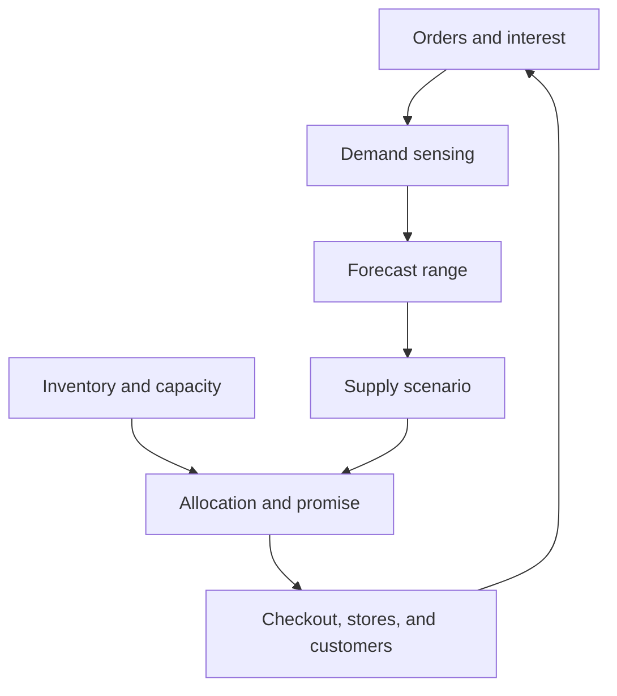

# Cross-Team Case — Six Days from Order to Availability

## The decision at the center of this case

Customers can order before launch-day delivery begins. The architecture must turn fast-changing demand into an honest promise without pretending that a forecast is inventory or that a factory can react in hours. The central question is simple: **What can we safely promise now, and what must change for later orders?**

## The customer promise

Orders open on Saturday, September 12. At checkout, customers see that the new phone will be available for delivery or pickup beginning Friday, September 18.

That is only six days.

A customer may think the company receives the order on Saturday, manufactures the phone, and delivers it by Friday. That is not how a large product launch normally works. Most launch-week units must already be built, quality-checked, transported, cleared through customs, and positioned in distribution centers or stores before orders open.

This case is about controlling the promise when actual demand becomes visible.

## Follow one example

At 8:00 a.m. Saturday, the company expects 100,000 orders in North Texas for the launch week. By noon, accepted orders reach 160,000.

The total number is not the only problem. Demand is uneven:

- Blue Pro 256 GB is 80% above forecast.
- Black Pro 256 GB is 25% below forecast.
- Dallas has excess demand while another region has unused inventory.
- One distribution center can ship only 18,000 units per day.
- Store pickup capacity is limited by staffing and secure storage.
- Additional factory output cannot reach Texas before Friday.

Teams 05, 06, and 07 must respond together.

## What can still change within six days?

| Decision | Can help September 18? | Why |
| --- | --- | --- |
| Increase factory production | Usually no | Component, assembly, test, international transport, and customs lead times are longer than six days. It helps later delivery waves. |
| Move finished units between regions | Possibly | It works only when stock exists elsewhere and transport can meet the cutoff. |
| Change warehouse or store allocation | Yes | Available inventory can be redirected before final shipment or pickup assignment. |
| Add warehouse shifts or carrier capacity | Yes | It can remove a fulfillment bottleneck, but cannot create missing phones. |
| Offer another color, storage option, or pickup location | Yes | It turns available substitutes into acceptable customer choices. |
| Change the delivery promise for new orders | Yes | It prevents the company from accepting promises it can no longer keep. |
| Change an already accepted promise | Last resort | It requires approval, customer communication, and a recovery offer. |

## The control loop students must design

1. **Sense demand.** Combine accepted orders with views, searches, carts, cancellations, bot scores, and store interest.
2. **Compare forecast with reality.** Measure the gap by model, color, storage, region, channel, and promised date.
3. **Check available-to-promise inventory.** Count only units that are sellable, reachable, and not already reserved.
4. **Find the actual constraint.** The shortage may be product inventory, warehouse throughput, store capacity, carrier capacity, or customs clearance.
5. **Run response options.** Test reallocation, substitution, extra shifts, faster transport, new production, or later delivery dates.
6. **Approve material changes.** Humans approve large regional transfers, premium freight, factory-plan changes, and customer-promise changes.
7. **Publish one decision.** Update checkout, order management, stores, warehouses, customer support, and dashboards from the approved version.
8. **Measure the result.** Track promise accuracy, cancellations, backlog, allocation fairness, expedite cost, and forecast error.

The loop may run every 15 minutes, but that does not mean every system changes every 15 minutes. Inventory and delivery promises can react quickly. Factory schedules need a frozen window so small demand changes do not create constant disruption.

## Ownership

| Team | Owns | Must provide |
| --- | --- | --- |
| Team 05 — Demand Forecasting | Updated demand range and confidence | Forecast version, assumptions, bot adjustment, unconstrained demand, and change from prior forecast |
| Team 06 — Manufacturing Planning | Feasible supply response for later waves | Component constraints, earliest additional output date, cost, risk, and approved production-plan version |
| Team 07 — Fulfillment and Delivery | Allocation and customer promise | Available-to-promise quantity, node capacity, carrier cutoff, promise date, and reason for any change |

Team 03 remains the authority for inventory holds and confirmed orders. No forecast or optimization model may directly create inventory.

## Delivery-date decision policy

Design a policy that answers these questions in order:

1. Is a sellable unit already available for this customer, configuration, and market?
2. Can a different distribution center or store meet September 18 without taking a unit already promised to someone else?
3. Can extra fulfillment or carrier capacity remove the bottleneck?
4. Will the customer accept an alternate color, storage option, pickup point, or later date?
5. If none of those work, what is the earliest date the supply plan can support?
6. Who may change the public checkout date, and who may change an already-confirmed customer promise?

The promise engine must use current, versioned inputs. It must never use a demand forecast as if it were physical inventory.

## Required data flow

For every arrow, define the event or API, owner, freshness target, version, and failure behavior.

## Architecture work

Your combined design must include:

- a near-real-time demand view by configuration, region, and channel;
- authoritative available-to-promise inventory;
- a constraint model for product, warehouse, store, carrier, and customs capacity;
- scenario planning for reallocation, substitution, premium freight, and later production;
- approval thresholds and a complete audit trail;
- a versioned delivery-promise service used by checkout and customer support;
- customer notification when a confirmed promise changes;
- a deterministic fallback when forecasting or optimization is unavailable;
- reconciliation when inventory, order, and shipment systems disagree.

## Quantitative exercise

Use these simulation inputs:

| Input | Value |
| --- | ---: |
| Forecast launch-week demand | 1,000,000 units |
| Finished launch inventory | 1,100,000 units |
| Actual accepted orders after 12 hours | 1,350,000 units |
| Hot configuration demand | 240,000 units |
| Hot configuration available inventory | 150,000 units |
| Under-demand configuration surplus | 70,000 units |
| Maximum regional transfer before Friday | 30,000 units |
| Daily fulfillment capacity | 210,000 units |
| Additional launch-week factory supply | 0 units |
| Earliest additional factory supply | September 29 |

Calculate:

1. the overall unit shortage;
2. the hot-configuration shortage;
3. how much of the hot-configuration gap regional transfer can cover;
4. the minimum days needed to fulfill 1.1 million available units at stated capacity;
5. the number of orders that need substitution, cancellation, or a later promise;
6. a delivery-date rule for orders arriving after the shortage is known.

Show units and assumptions. Do not hide the shortage inside an ML model.

## Failure injection

At 2:00 p.m. Saturday, the event stream is delayed by 25 minutes while checkout continues accepting orders. The forecasting dashboard looks healthy, but its inputs are stale.

Explain:

- how the stale-data condition is detected;
- whether checkout continues accepting September 18 promises;
- what conservative buffer or rule is used;
- who is paged;
- how decisions are reconciled after replay;
- how customers are treated if the system made a promise using stale data.

## Questions for the review panel

- If production cannot help this Friday, why does Team 06 still need the first-day order signal?
- When should the company stop promising September 18?
- Is it fair to move inventory from a low-demand region to a high-demand region?
- Should existing customers keep priority over higher-value new orders?
- What happens when inventory exists but the warehouse cannot ship it in time?
- Which number is the source of truth for a customer promise?
- How often may the forecast, allocation plan, production plan, and public delivery date change?
- What business evidence would justify premium freight or a second production shift?

## What students should learn

A launch is not one forecast followed by one production run. It is a controlled decision loop across demand, inventory, supply, fulfillment, and customer promises.

The key architectural insight is time horizon:

- **Seconds to hours:** protect orders, reservations, and truthful checkout dates.
- **Hours to days:** rebalance inventory and fulfillment capacity.
- **Weeks to months:** change components, factory capacity, and production.

A good architecture makes those different speeds work together without allowing a fast signal to create a reckless long-term decision.

---

[← Challenge home](README.md) · [Team 05](TEAM-05-DEMAND-FORECASTING.md) · [Team 06](TEAM-06-MANUFACTURING-PLANNING.md) · [Team 07](TEAM-07-FULFILLMENT-DELIVERY.md)
