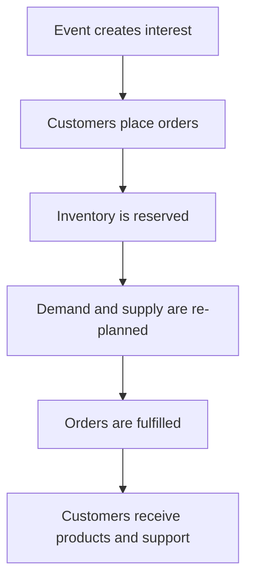

# Shared Challenge: Apple Event Enterprise Launch

## Start here: one launch, ten connected decisions

This is one company story, not ten unrelated technology assignments. A successful launch depends on every team making decisions that agree with the others.

Security, resilience, operations, and customer intelligence apply across the entire flow.

Before opening a team brief:

1. Read the [Solutions Architect Use-Case Playbook](../../SOLUTIONS_ARCHITECT_USE_CASE_PLAYBOOK.md).
2. Read the shared launch story on this page.
3. Open your assigned team brief.
4. Meet neighboring teams early and agree on interface ownership.
5. Use the [submission template](SUBMISSION_TEMPLATE.md) to tell one coherent story.

## Begin here

Read the story once without discussing products or cloud services. Then follow one imaginary customer from watching the event to receiving a device. Every time ownership moves from one team to another, mark that handoff. Those handoffs are where enterprise systems usually become difficult.

## Your mission

Apple has announced the “Surprise and shine” event for September 9, 2026 at 10:00 a.m. Pacific Time. For this educational simulation, assume an unknown set of products is revealed and orders open at X:00 p.m. PT. You are not designing Apple’s real systems. You are acting as an enterprise architecture team for a fictional global technology company facing the same business event.

A customer sees one launch. Behind it, video, digital commerce, payments, inventory, stores, supply planning, factories, logistics, security, analytics, ML, and customer care must behave as one enterprise.

## Why this is difficult

The event creates a step change, not normal daily growth. Interest appears before confirmed orders. The company has limited inventory, long manufacturing lead times, different country rules, unreliable external providers, and no tolerance for charging customers twice or promising the same product twice.

Your architecture must work at scale, survive failure, protect private information, provide explainable business decisions, and remain useful when ML is unavailable.

## Fixed simulation facts

| Fact | Value |
| --- | ---: |
| Peak concurrent viewers | 20 million |
| Countries and regions | 100+ |
| Commerce peak | 2 million HTTP requests/second |
| First-hour order attempts | 8 million |
| Sellable configurations | 60 |
| Retail stores | 520 |
| Distribution centers | 35 |
| Supplier and manufacturing sites | 40 |
| Event telemetry | 3 million events/second at peak |
| Checkout SLO | 99.99% during the launch window |
| Inventory oversell tolerance | 0 confirmed oversells |
| Command-center freshness | 60 seconds or less |
| Personally identifiable information | Must remain within approved region |
| Factory lead time | 2–12 weeks, depending on component |

Treat these as peak planning inputs. Show your calculation and assumptions rather than simply repeating the number.

## Shared business timeline

- T-30 days: forecasts, inventory placement, capacity tests, security reviews, and rehearsals.
- T-15 minutes: livestream waiting rooms fill and storefront browsing rises.
- 10:00 a.m. PT: global event begins.
- During reveal: engagement, product search, and social sentiment change in seconds.
- X:00 p.m. PT: orders open by approved market.
- X+20 minutes: one hot configuration consumes most available-to-promise stock.
- X+45 minutes: a downstream dependency becomes unhealthy.
- Same day: allocation, delivery promises, store preparation, and production plans change.
- Following weeks: factories, suppliers, logistics, returns, support, and forecast learning continue.

## Enterprise flow

Watch → Engage → Order → Pay → Reserve → Forecast → Plan → Manufacture → Allocate → Deliver → Support → Learn

## Rules

1. Begin with business outcomes and stakeholders. Do not begin with cloud services.
2. Separate facts, assumptions, constraints, and decisions.
3. Every major technology box needs a responsibility and a reason.
4. Identify systems of record for product, price, customer, order, payment, inventory, forecast, production, and shipment.
5. Define where strong consistency is essential and where eventual consistency is acceptable.
6. Handle duplicates, retries, late messages, out-of-order events, partial failure, and replay.
7. Include an operating model: owner, dashboard, alert, on-call action, recovery, and audit.
8. ML must have evaluation, drift monitoring, human control, and a deterministic fallback.
9. Do not claim “auto scaling” or “multi-region” without explaining trigger, state, failover, and recovery.
10. Your team must integrate with at least three other teams using named APIs or business events.

## Required student package

Submit:

- One-page business capability and stakeholder view
- Context diagram and end-to-end sequence
- Logical application architecture
- Data ownership and system-of-record table
- Three API or event contracts
- Capacity model with units and peak calculations
- SLOs, RTO, RPO, consistency, and data-freshness targets
- Threat model and privacy controls
- Two architecture decision records
- ML lifecycle and fallback, when applicable
- Two normal scenarios and three failure scenarios
- Observability dashboard with technical and business signals
- Cost drivers and one cost-control decision
- Cross-team dependency map
- Three-minute executive explanation and seven-minute technical defense

Use the [submission template](SUBMISSION_TEMPLATE.md). Your team brief adds requirements to this common set.

## Review questions

Be ready to answer:

- What customer or business harm occurs if your design fails?
- What is the first bottleneck at 10x and 20x load?
- What data can be lost, and how much?
- How do you know the system is healthy from a customer’s point of view?
- What happens when a message is delivered twice?
- What happens when the same operation times out but actually succeeded?
- Who may override an automated decision, and how is that recorded?
- What evidence would cause you to reverse your biggest architecture decision?
- How does your design degrade safely instead of failing completely?
- Which assumption creates the greatest risk?

## Teams

| Team | Challenge |
| --- | --- |
| 01 | [Global livestream](TEAM-01-GLOBAL-LIVESTREAM.md) |
| 02 | [Digital store and checkout](TEAM-02-DIGITAL-STORE-CHECKOUT.md) |
| 03 | [Inventory reservation and order integrity](TEAM-03-INVENTORY-ORDER-INTEGRITY.md) |
| 04 | [Real-time launch command center](TEAM-04-LAUNCH-COMMAND-CENTER.md) |
| 05 | [ML demand sensing and forecasting](TEAM-05-DEMAND-FORECASTING.md) |
| 06 | [Supply, supplier, and manufacturing planning](TEAM-06-MANUFACTURING-PLANNING.md) |
| 07 | [Allocation, fulfillment, and delivery promise](TEAM-07-FULFILLMENT-DELIVERY.md) |
| 08 | [Retail store demand and workforce](TEAM-08-RETAIL-STORE-OPERATIONS.md) |
| 09 | [Customer intelligence and AI support](TEAM-09-CUSTOMER-INTELLIGENCE.md) |
| 10 | [Security, fraud, bots, and resilience](TEAM-10-SECURITY-RESILIENCE.md) |

## Shared launch-to-delivery case

Teams 05, 06, and 07 must work together on the [six-day order-to-delivery case](CROSS-TEAM-CASE-ORDER-TO-DELIVERY.md). Orders are accepted on Saturday for Friday availability. The case asks what can still change within six days, when production can help, and when the company must change its delivery promise.

Also review the [shared interface catalog](SHARED-INTERFACE-CATALOG.md) and [challenge cards](CHALLENGE-CARDS.md).

---

[← Challenge home](README.md) · [Submission template](SUBMISSION_TEMPLATE.md) · [Course map](../../COURSE_MAP.md)
